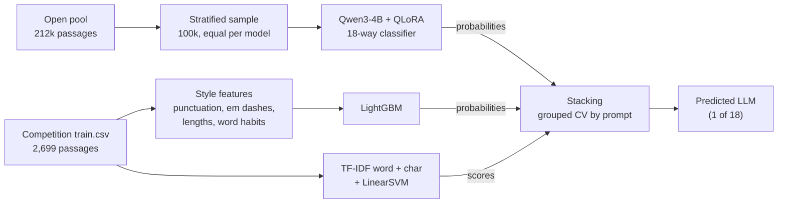

# Name That LLM

My solution to the Kaggle competition [Name That LLM](https://www.kaggle.com/competitions/name-that-llm).

## The problem

Given a short passage (40 to 250 words), predict which of 18 frontier LLMs wrote it. Every training prompt was answered by all 18 models, and the hidden test set uses unseen prompts, so topic gives nothing away and only writing style does. The score is balanced accuracy, and submissions are notebook-only: Kaggle re-runs the notebook offline on the hidden test set.

## Architecture

## How it works

Three different views of the same passage are combined. The fine-tuned Qwen3-4B learns style directly from 100k external passages (4-bit weights with LoRA adapters, so it fits on an 8 GB GPU). A LightGBM model learns from hand-made style features such as punctuation habits, em dash frequency and sentence lengths. A TF-IDF linear SVM on word and character n-grams catches exact wording. Their probabilities are blended by a small stacking model. The competition's own `train.csv` is never used to train the Qwen model, so it serves as a clean validation set, always split by prompt so that topics cannot leak. The TF-IDF model is done (public score 0.348), the Qwen fine-tune is in progress, and the LightGBM part is next.

## Credits

- [Kaggle](https://www.kaggle.com/competitions/name-that-llm) for the competition and its data.
- [Name That LLM Open Pool](https://www.kaggle.com/datasets/crtproduction/name-that-llm-open-pool) by crtproduction, a merge of many community datasets (CC BY 4.0, CC BY-SA 4.0 and CC0; the per-source list is in the dataset's `sources.csv`). Thanks to all the authors who generated and shared passages.
- [Qwen3](https://github.com/QwenLM/Qwen3) by the Qwen team (Apache 2.0).
- Hugging Face Transformers and PEFT, bitsandbytes, PyTorch, LightGBM and scikit-learn.

Released under the [MIT License](LICENSE).
