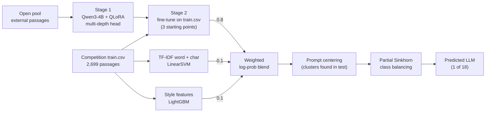

# Name That LLM

My solution to the Kaggle competition [Name That LLM](https://www.kaggle.com/competitions/name-that-llm).

**Current public leaderboard score: 0.572** (balanced accuracy, 18 classes; chance is 0.056).

## The problem

Given a short passage (40 to 250 words), predict which of 18 frontier LLMs wrote it. Every training prompt was answered by all 18 models, and the hidden test set uses unseen prompts, so topic gives nothing away and only writing style does. The score is balanced accuracy, and submissions are notebook-only: Kaggle re-runs the notebook offline (2x T4) on about 4,000 hidden passages.

## Architecture

## How it works

1. **Stage 1: learn style from external data.** Qwen3-4B base, loaded in 4 bits with LoRA adapters so it trains on an 8 GB laptop GPU, is fine-tuned on up to 92k passages from the open pool. The classifier head does not use only the last layer: it mean-pools 8 depths of the first 24 layers and concatenates them, because style lives in the middle layers as much as at the top.
2. **Stage 2: adapt to the competition's own text.** Each stage-1 model is fine-tuned again on `train.csv` (2 epochs, small learning rate). This step alone adds 4 to 8 points, because the external pool is written differently from the host's data. Three stage-1 starting points give three stage-2 models, which are averaged.
3. **Two cheap, different views.** A linear SVM on word and character n-grams catches exact wording, and LightGBM on hand-made style features (punctuation, em dashes, sentence lengths, word habits) catches formatting habits.
4. **Prompt centering.** The hidden test contains several passages per prompt. The notebook finds those groups by text similarity and subtracts half of each group's average prediction, so what the passages share (the topic) cancels and what differs (the style) remains. This was +1.7 on the leaderboard.
5. **Partial Sinkhorn.** The predictions are pushed part of the way (45%) towards "every model gets an equal share of the test", which corrects the model's bias towards a few favourite classes without trusting the test to be perfectly balanced.

**Validation.** Every number here is out-of-fold on `train.csv`, split by prompt (GroupKFold, 5 folds) so a topic never appears on both sides. Fold 4 is a lockbox, kept for one final check. Out-of-fold scores run about 2 to 3.5 points above the leaderboard.

## Leaderboard history

| Version | Change | Public LB |
|---|---|---|
| TF-IDF + SVM | first baseline | 0.348 |
| TF-IDF + LightGBM | style features added | 0.402 |
| Qwen v3 | stage-2 Qwen3-4B blend | 0.550 |
| Qwen v4 | three stage-2 starting points | 0.555 |
| Qwen v5 | prompt centering | **0.572** |

## What did not work

Each idea was tested out-of-fold and kept only if it clearly helped:

- **External or regenerated rows in stage 2:** -2.6 to -2.9. Only the host's own text helps at that stage.
- **Adversarial ideas** (sibling duel specialists, an error-focused booster, a "not its sibling" margin loss, FGM adversarial training): all flat or worse. The confusions between sibling models come from missing signal, not a weak decision layer.
- **Hard group assignment** (each model used once per prompt group): 0.367 on the leaderboard, because the test groups are not complete 18-model sets. Soft centering works where hard assignment fails.
- **Sibling-style residual, four-view n-gram SVM, shared-prompt Gaussian:** each was at most +0.3 to +0.6, within noise. The Qwen models already carry that information.
- **Higher dropout, pseudo-labelling, more epochs:** no gain.

## In progress

- Stage 2 from a fourth stage-1 model trained on more pool data (its stage-1 score is the best so far).
- Qwen3-8B as a second, larger backbone, trained on Kaggle GPUs.

## Repository layout

- `finetune/`: stage-1 and stage-2 training (`train.py`), job control and prediction.
- `kernel_qwen/`: the submission notebook.
- `research/`: experiment trainer, blend fitting, component tests, and the experiment journal (`JOURNAL.md`, `results.tsv`).
- `features/`: frozen-feature extraction and post-processing tests.
- `kaggle_train/`, `kaggle_main/`, `kaggle_research/`: runners for training on Kaggle GPUs.
- `dashboard/`: a local page for following training loss, recall and confusion matrices.

## Credits

- [Kaggle](https://www.kaggle.com/competitions/name-that-llm) for the competition and its data.
- [Name That LLM Open Pool](https://www.kaggle.com/datasets/crtproduction/name-that-llm-open-pool) by crtproduction, a merge of many community datasets (CC BY 4.0, CC BY-SA 4.0 and CC0; the per-source list is in the dataset's `sources.csv`). Thanks to all the authors who generated and shared passages.
- Public competition notebooks, including "Name That LLM | Who am I?" by romantamrazov, for ideas tested here (partial Sinkhorn, sibling residual, shared-prompt Gaussian, multi-view SVM). The implementations in this repository are my own.
- [Qwen3](https://github.com/QwenLM/Qwen3) by the Qwen team (Apache 2.0).
- Hugging Face Transformers and PEFT, bitsandbytes, PyTorch, LightGBM and scikit-learn.

Released under the [MIT License](LICENSE).
